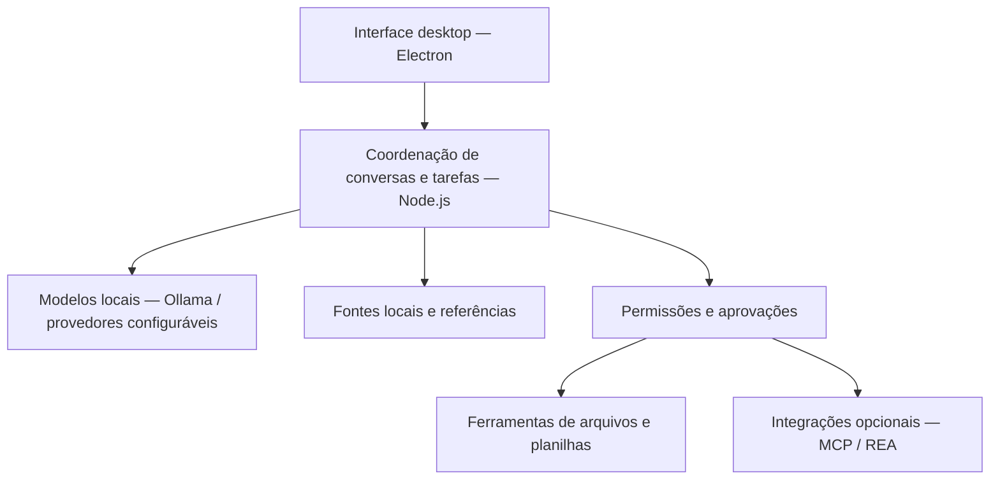

# Jarvis — Assistente Pessoal

Assistente desktop em desenvolvimento para reunir conversas com IA, consulta a fontes locais e ferramentas com aprovação em uma única interface.

**Tecnologias:** Node.js · Electron · Ollama

**Disponibilidade:** portfólio documental; código e executáveis privados.

## Proposta e minha participação

O projeto explora como adaptar uma base de assistente de programação para fluxos de um assistente pessoal desktop. Minha participação envolve a adaptação para o Jarvis, sua interface, integrações e organização dos fluxos, com desenvolvimento assistido por IA. A base de terceiros é identificada nos créditos abaixo; não apresento todo o código como criação original.

## Funcionalidades presentes

- Interface desktop para conversar e selecionar modelos/provedores.
- Integração com Ollama para uso de modelos locais e suporte a provedores configuráveis.
- Ferramentas de leitura, escrita e edição com permissões e verificações.
- Área de fontes locais, busca de conhecimento e referências aos materiais consultados.
- Fluxos de inspeção, comparação e reconciliação de planilhas.
- Integrações opcionais com REA/MCP e fluxos de projetos assistidos.

A presença desses recursos no projeto não significa validação de todos os modelos, provedores ou cenários. Integrações opcionais continuam em desenvolvimento e validação.

## Tecnologias e responsabilidades

| Tecnologia | Papel no projeto |
| --- | --- |
| Node.js | Execução da lógica e integração entre módulos |
| Electron | Aplicação e interface desktop |
| Ollama | Integração com modelos locais |
| ExcelJS | Manipulação de planilhas |
| PDF.js | Leitura de documentos PDF |
| Playwright | Recursos de automação de navegador |
| MCP | Integrações opcionais com ferramentas externas |

## Arquitetura conceitual

O diagrama resume responsabilidades e não representa uma garantia de isolamento ou de segurança.

## Desafios técnicos e aprendizados

- **Integrar interface e execução:** organizar a troca de informações entre a janela desktop e a lógica do assistente.
- **Controlar ações:** distinguir uma resposta do modelo de uma operação que exige autorização.
- **Trabalhar com fontes:** manter o contexto dos materiais selecionados e apresentar referências.
- **Lidar com variações dos modelos:** tratar configuração, disponibilidade e diferenças de comportamento entre provedores.
- **Revisar desenvolvimento assistido por IA:** conferir resultados e reconhecer os limites das validações realizadas.

Essas frentes exercitam integração de sistemas, organização de módulos, tratamento de falhas e revisão de comportamento.

## Estado atual e limitações

- Desenvolvimento e validações relatadas principalmente em Windows com Ollama/Qwen.
- Sem instalador Windows configurado.
- Fluxos REA/MCP e integrações externas exigem validação por cenário.
- Respostas de IA podem conter erros; resultados e operações precisam de revisão.
- Código-fonte indisponível publicamente enquanto procedência e licenciamento permanecem em revisão. Este repositório não distribui código, testes, dependências, executáveis ou histórico do aplicativo.

## Roadmap

- Ampliar a validação dos fluxos existentes e de suas permissões.
- Evoluir a proposta de hub de IAs e ferramentas.
- Explorar integração Codex, automações com controles explícitos e integrações acadêmicas.

Esses itens são planos, sem promessa de entrega ou indicação de implementação concluída.

## Demonstração e privacidade

Não há captura aprovada e sanitizada disponível para esta apresentação. Conversas, documentos, credenciais, caminhos pessoais e dados profissionais não integram o portfólio. Futuras demonstrações devem utilizar somente dados sintéticos.

## Créditos e procedência

O Jarvis foi desenvolvido sobre uma base relacionada ao [Open Claude Code](https://github.com/ruvnet/open-claude-code), cujo projeto documenta pesquisa de código associada ao [ruDevolution](https://github.com/ruvnet/ruDevolution).

Esta apresentação reconhece a base de terceiros e o trabalho específico de adaptação para o Jarvis. Não afirma uma implementação independente de toda a base, não conclui sobre direitos de redistribuição e não concede licença de software.
